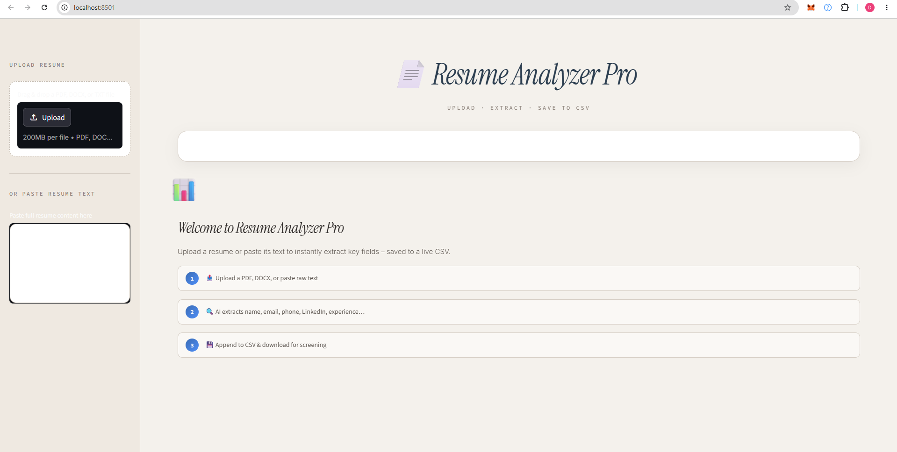
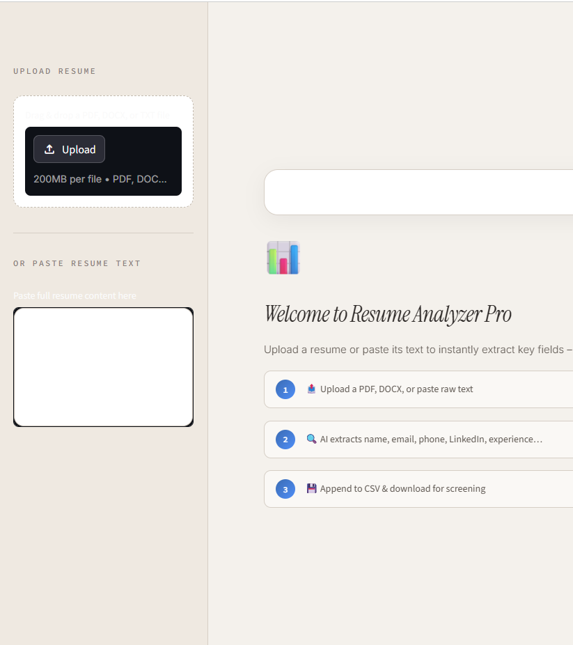
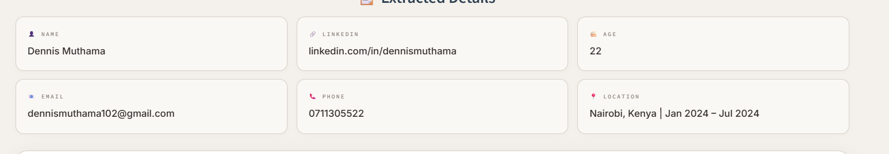
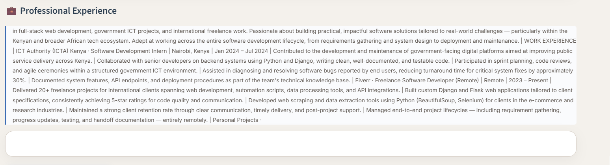

<div align="center">

<br/>

## resume parser

```json
{ "input": "resume.pdf", "output": "structured data", "reading": "not required" }
```

<br/>

</div>


</div>

---

## ❓ What is this?
  **MAINLY FOR EMPLOYERS**
Most resume parsers are either locked behind expensive APIs or produce messy, unreliable output. **Resume Parser** is a lightweight, locally-runnable Streamlit web app that takes any resume — PDF, DOCX, TXT, or plain pasted text — and surgically extracts the information that actually matters.

Once all that information is extracted it is placed in a downloadable CSV file and then it will enable the employer to sort with the needs they want.<br>
They can search the requirements and get the candidates With those particular aspects.<br>
  The aspects can vary from candidates who have worked at partcular organization,gone to a certain school,years of experience.....you name any metric you want to filter the candidates with 

---
**website dashboard**
      

## 🖼️ Screenshots  

<table>
  <tr>
    <td align="center"><b>📂 Upload Interface</b></td>
    <td align="center"><b>📋 Parsed Output</b></td>
  </tr>
  <tr>
    <td>
      <!-- Replace with your screenshot -->
      
    </td>
    <td>
      <!-- Replace with your screenshot -->
      
    </td>
  </tr>
  <tr>
    <td align="center"><b>✏️ Work experience   EXTRACTED</b></td>
    <td align="center"><b>📊 Extracted CSV File for downloading</b></td>
  </tr>
  <tr>
    <td>
      <!-- Replace with your screenshot -->
      
    </td>
    <td>
      <!-- Replace with your screenshot -->
      
    </td>
  </tr>
</table>


---

## ⚙️ What it extracts

The parser targets the fields that hiring tools, recruiters, and ATS systems care about most:

```
┌─────────────────────────────────────────────────────────────┐
│                    EXTRACTED FIELDS                         │
├──────────────────────┬──────────────────────────────────────┤
│  👤  Full Name        │  Detected from resume header         │
│  📧  Email Address    │  Primary contact email               │
│  📍  Location         │  City / Country / Region             │
│  🔗  LinkedIn URL     │  Profile link                        │
│  🌐  Other Links      │  GitHub, portfolio, personal site    │
│  💼  Job Title        │  Current or most recent role         │
│  🏢  Work Experience  │  Companies · Roles · Durations       │
└──────────────────────┴──────────────────────────────────────┘
```

---

## 🧠 How the extraction actually works

This isn't a single-method parser — it runs a **three-layer hybrid pipeline** to maximise accuracy across different resume styles and formats:

```
INPUT (PDF / DOCX / TXT / Paste)
        │
        ▼
┌───────────────────┐
│  Text Extraction  │  ← PyMuPDF / pdfplumber (PDF) · python-docx (DOCX) · raw string (TXT/paste)
└────────┬──────────┘
         │
         ▼
┌───────────────────┐
│  Regex Layer      │  ← Fast, deterministic pattern matching for emails, URLs, phones
└────────┬──────────┘
         │
         ▼
┌───────────────────┐
│  NLP Layer        │  ← spaCy Named Entity Recognition + NLTK for names, orgs, locations
└────────┬──────────┘
         │
         ▼
┌───────────────────┐
│  AI Refinement    │  ← LLM cleans up ambiguous fields where NLP is uncertain
└────────┬──────────┘
         │
         ▼
  STRUCTURED OUTPUT (displayed in Streamlit UI)
```

Each layer feeds into the next — regex handles the clear-cut stuff, NLP picks up semantic patterns, and AI fills the gaps.

---

## 🛠️ Tech Stack

| What | How |
|------|-----|
| **App Framework** | Streamlit |
| **Language** | Python 3.10+ |
| **PDF Extraction** | PyMuPDF · pdfplumber |
| **DOCX Extraction** | python-docx |
| **NLP Engine** | spaCy · NLTK |
| **AI Layer** | Gemini API · OpenAI API |
| **Pattern Matching** | Regex (re module) |

---

## 🚀 Running it locally

**1. Clone the repo**
```bash
git clone https://github.com/your-username/resume-parser.git
cd resume-parser
```

**2. Set up a virtual environment**
```bash
python -m venv venv

# macOS / Linux
source venv/bin/activate

# Windows
venv\Scripts\activate
```

**3. Install dependencies**
```bash
pip install -r requirements.txt
```

**4. (Optional) Add your API key**

If you're using the AI refinement layer, create a `.env` file:
```env
GEMINI_API_KEY=your_key_here
# or
OPENAI_API_KEY=your_key_here
```

**5. Launch**
```bash
streamlit run app.py
```

Visit `http://localhost:8501` — that's it.

---


---

## 🗺️ Features

- [x] PDF, DOCX, TXT upload support
- [x] Raw text paste mode
- [x] Name, email, location, LinkedIn, links extraction
- [x] Job title detection
- [x] Work experience parsing


## 📄 License

[MIT](LICENSE) — free to use, modify, and build on.

---

<div align="center">
 
</div>
